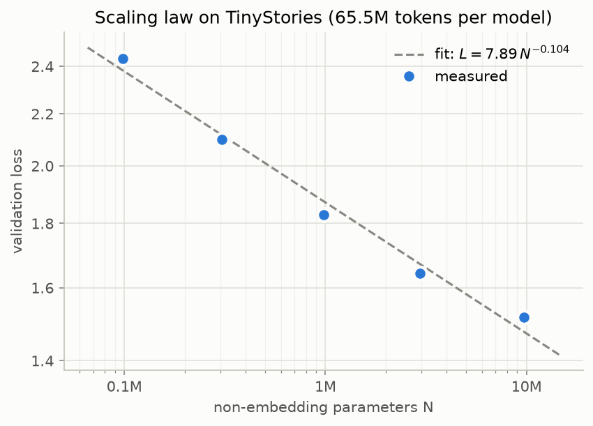
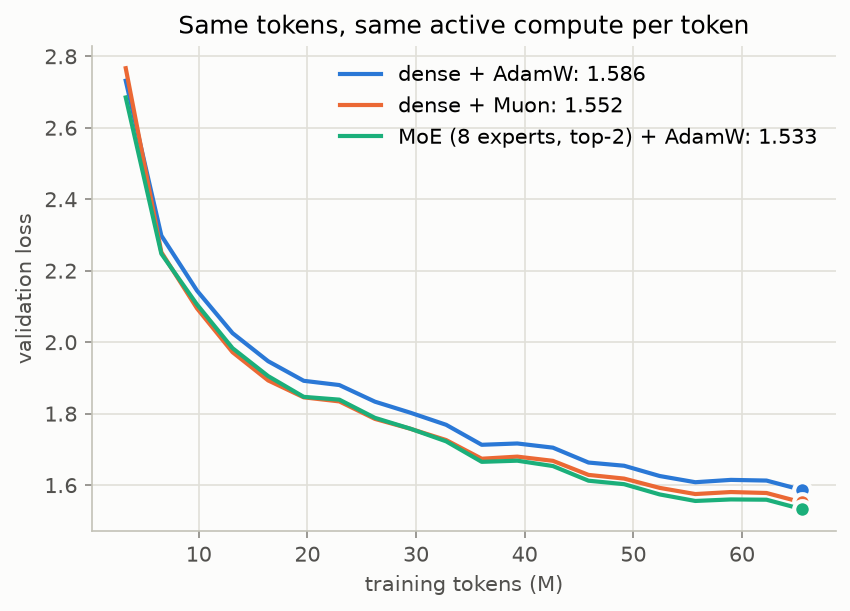

# llama-from-scratch

[](https://github.com/Magikdidi24/llama-from-scratch/actions/workflows/tests.yml)

A small Llama-style language model written from scratch in PyTorch and pretrained on [TinyStories](https://arxiv.org/abs/2305.07759) with my own GPU (RTX 5070 Ti). Once the base model worked I used it to try a few things I had been reading about: [scaling laws](https://arxiv.org/abs/2001.08361), the [Muon](https://kellerjordan.github.io/posts/muon/) optimizer and [mixture of experts](https://arxiv.org/abs/2401.04088).

`model.py` has the usual Llama parts: RMSNorm, rotary embeddings, grouped-query attention, SwiGLU, an output head tied to the embeddings and a KV cache for sampling. With `--n_experts 8` every feed-forward turns into a Mixtral-style MoE where each token goes to 2 of the 8 experts. The experts are half as wide as the dense FFN so the compute per token doesn't change, and a Switch Transformer balancing loss keeps the router from sending everything to the same experts. `--optimizer muon` puts the 2D weights of the blocks on `torch.optim.Muon` and keeps AdamW for the rest.

The tokenizer is a byte-level BPE with 4096 tokens, trained on the first 700 MB of TinyStories (about 182M tokens).

## Results

All the runs below are on the 5070 Ti, in bf16 with `torch.compile`.

### Main model

Width 384, 6 layers, 9.7M params without the embeddings. It trains on 164M tokens, so about 17 tokens per param, and ends at a val loss of 1.40 after 5.5 min of training.

What it writes from "Once upon a time" (temperature 0.8, top-k 50):

> Once upon a time, in a small town, there was a little girl named Lily. Lily loved to play with her toys. One day, she found a cold, old box in her room. She was very curious about what was inside.
> Lily opened the box and found a pretty dress. She wanted to wear the dress to the party. But, when she went outside, she saw that the wind had blown her dress away. Lily was very sad.
> Then, something unexpected happened! The wind took off the dress and started to dance. Lily laughed and danced with the wind. They had so much fun at the party. The end.

Grammar is mostly fine, but the stories don't always make sense and it sometimes repeats itself ("Tom and Lily wanted to build a boat for their boat. They took some wood and some wood...", that one at temperature 0.6). Generation can't go past 256 tokens, the context length, since there's no sliding window.

### Scaling law

5 dense models from 0.1M to 10M params, all trained on the same 65.5M tokens, then a straight line in log-log.



| params | dim | layers | val loss |
|---:|---:|---:|---:|
| 0.10M | 64 | 2 | 2.436 |
| 0.30M | 96 | 3 | 2.100 |
| 0.98M | 128 | 5 | 1.830 |
| 2.95M | 256 | 4 | 1.643 |
| 9.74M | 384 | 6 | 1.516 |

The fit is `L = 7.89 * N^-0.104`. Kaplan et al. get 0.076 for the exponent, but it's only 5 runs with one seed and no lr tuning per size, so I wouldn't read much into it. The biggest model is already above the line: with 65M tokens it only gets ~7 tokens per param, so it's probably short on data more than on size.

### Muon and MoE

The default model (width 256, 6 layers, 4.4M params) trained 3 ways on the same 65.5M tokens. The MoE has 14.2M params in total but still 4.4M active per token, like the dense ones.



| run | val loss | training time |
|---|---:|---:|
| dense + AdamW | 1.586 | 2.0 min |
| dense + Muon | 1.552 | 4.7 min |
| MoE (8 experts, top-2) + AdamW | 1.533 | 15.4 min |

Both beat the AdamW baseline, and the gap is there for most of the run, not only at the end. Muon just reuses AdamW's learning rate through `match_rms_adamw`, I didn't tune anything. The MoE gets the best loss but takes almost 8x longer, probably because of my plain Python loop over the experts. One seed per run.

## Running it

You need a CUDA GPU for the real runs, I used the 5070 Ti. All the runs together are about 35 min of training, plus the download and tokenizer at the start.

```bash
pip install -r requirements.txt
python data.py
python train.py --dim 384 --n_layers 6 --max_steps 20000 --warmup_steps 500 --eval_every 1000 --compile
python sample.py "Once upon a time"
python experiments.py scaling --compile
python experiments.py ablations --compile
```

Checkpoints and json metrics end up in `out/`, plots in `assets/`. Every training setting is a flag, see `python train.py --help`.

`pytest -q` runs the tests on CPU in a few seconds. To check the whole pipeline without a GPU there are tiny configs (they overwrite `data/` and `out/`):

```bash
python data.py --mb 20
python train.py --dim 64 --n_layers 2 --n_heads 4 --n_kv_heads 2 --seq_len 64 --batch_size 16 --max_steps 50 --warmup_steps 5 --eval_every 10
python experiments.py scaling --quick
python experiments.py ablations --quick
```
